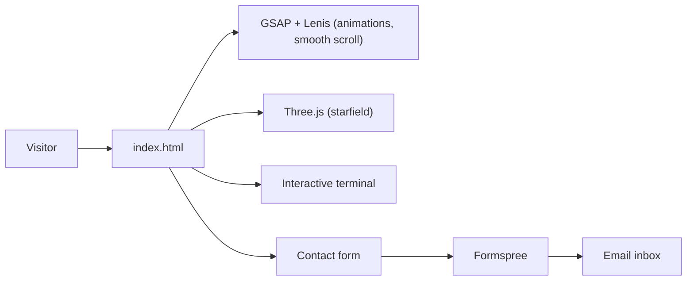

<div align="center">

# Shiva Saran — Portfolio

**Full-Stack Developer · Chennai**

A single-page portfolio with an interactive terminal, scroll animations and a 3D starfield.

[](https://YOUR-DOMAIN.com)
[](https://www.linkedin.com/in/shiva-saran-7b3605324)
[](https://github.com/saran-77)
[](mailto:shivasaran757@gmail.com)

</div>

---

## Contents

- [Features](#features)
- [Try the terminal](#try-the-terminal)
- [Projects featured](#projects-featured)
- [Tech used](#tech-used)
- [Run locally](#run-locally)
- [Deploy](#deploy)
- [Project structure](#project-structure)

---

## Features

- **Interactive terminal**: type commands in the hero section to explore the site
- **Name scramble animation**: the name decodes letter by letter, then shimmers
- **Scroll reveals**: the tech stack and sections animate in as you scroll
- **3D effects**: a Three.js starfield, a tilting terminal and project cards
- **Working contact form**: messages are delivered through Formspree
- **SEO ready**: meta tags, Open Graph, structured data, sitemap and robots.txt
- **Responsive and accessible**: works on mobile and respects "reduce motion"

---

## Try the terminal

Click the terminal on the home page and type `help`.

<details>
<summary><b>Show all commands</b></summary>

| Command | What it does |
|---|---|
| `help` | List all commands |
| `whoami` | Short intro |
| `about` | Background and focus |
| `stack` | Tools and languages |
| `projects` | Featured work |
| `experience` | Education and internship |
| `contact` | Email and socials |
| `open work` | Scroll to the projects |
| `ls`, `pwd`, `date`, `echo` | Classic shell commands |
| `clear` | Clear the screen |

**Tips:** Press `Tab` to autocomplete and use the `↑` / `↓` keys to move through your history.
Try `sudo` for a surprise.

</details>

---

## Projects featured

<details>
<summary><b>Chatley</b> — private real-time chat</summary>

- Google sign-in, live messaging and media sharing
- Privacy enforced in the database with row-level security
- **Stack:** React · TypeScript · Vite · Tailwind · Supabase · Vercel
- **Live:** [chatley-five.vercel.app](https://chatley-five.vercel.app)

</details>

<details>
<summary><b>CURA</b> — medication care for patients and caregivers</summary>

- One Expo app with separate patient and caregiver modes
- Medication reminders that work without internet
- Nightly AI summaries generated securely on the server
- **Stack:** React Native · Expo · Supabase · Edge Functions · OpenRouter

</details>

<details>
<summary><b>LearnLoop</b> — AI-powered learning app</summary>

- Step-by-step learning phases with voice input
- AI responses from Groq, with API keys kept on the server
- **Stack:** React · TypeScript · Vite · Supabase · Groq · Expo
- **Live:** [learnloop-orpin.vercel.app](https://learnloop-orpin.vercel.app)

</details>

---

## Tech used


No build step and no framework: everything lives in a single `index.html`.



---

## Run locally

```bash
# any static server works
npx serve .
# then open http://localhost:3000
```

<details>
<summary>Why not just double-click index.html?</summary>

The page will open, but the contact form may be blocked by Formspree when it runs
from a `file://` address. A local server avoids that.

</details>

---

## Deploy

1. Push this folder to GitHub.
2. Import it on **Vercel**, **Netlify** or **GitHub Pages**. There is nothing to build.
3. Replace `YOUR-DOMAIN.com` with your real domain in `index.html`, `robots.txt` and `sitemap.xml`.
4. Submit `sitemap.xml` in [Google Search Console](https://search.google.com/search-console).

---

## Project structure

```
portfolio/
├── index.html    # the whole site: HTML, CSS and JS
├── robots.txt    # crawler rules
└── sitemap.xml   # page list for search engines
```

---

<div align="center">

Built by **Shiva Saran** · © 2026

</div>
